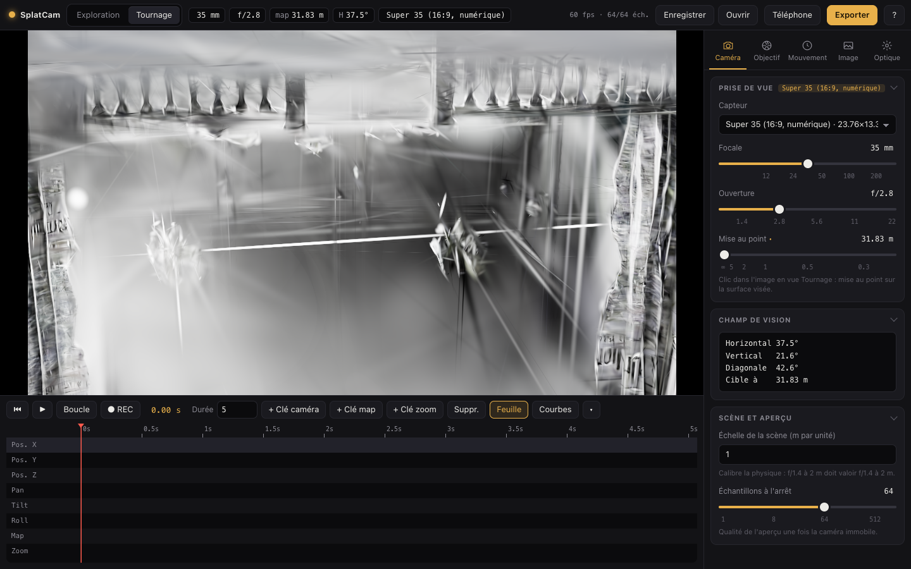

# SplatCam

**A cinema camera for Gaussian Splat scenes.**

SplatCam treats a Gaussian Splat capture like a film set. You place a real camera with a real lens, plan its moves on a timeline, then export a cinema-grade render as a 16-bit image sequence or an MP4 preview.

The rendering aims to be physically believable: a lens at f/1.4 focused at 2 m behaves like f/1.4 at 2 m. Everything is expressed in meters through an adjustable scene scale.

The app runs locally in Chrome on an Apple Silicon Mac. No remote server, no account, no telemetry: nothing leaves your machine.



> **Status: v0.1, personal use.** The main features are in place and tested. Several still need to be checked by eye on real scenes (see the [CHANGELOG](CHANGELOG.md)). The development log in `docs/` is written in French.

---

## Why it's different

Splats don't write to the depth buffer, so a depth-based post-process depth of field is impossible. SplatCam works like a real camera instead: it **accumulates hundreds of sub-renders** in linear HDR.

- Each sub-render moves the camera to a point on the lens pupil and places it at an instant within the shutter window. Sampling is stratified (Halton) jointly over aperture and time.
- The projection is sheared so the focal plane always lands on the same pixel. What is in focus stays sharp, and everything else blurs exactly according to the circle of confusion.
- The bokeh's character comes entirely from the distribution of aperture samples: blade shape, onion rings, cat-eye, swirl, spherical aberration, anamorphic squeeze.
- Motion blur comes from the same mechanism: each sample reads the camera, focus and zoom at its own instant.

While exploring, the preview runs with few samples. As soon as the camera stops, the image refines progressively up to the target count. Export can go up to 1024 samples per frame.

## Main features

### Camera and lens
- **Sensor formats** from Super 8 to medium format (Super 16, Super 35, Full Frame…). Horizontal, vertical and diagonal field of view are computed and displayed.
- **Two cameras**: a free exploration camera and a shooting camera framed to the sensor's aspect ratio.
- **34 lenses**, including 24 real-world series (ARRI, Cooke, Zeiss, Leica, Canon, anamorphics, zooms, vintage), with their focal lengths, maximum aperture, minimum focus distance and optical flaws.
- Physical **depth of field**: aperture from f/1.2 to f/22, focus in meters or by clicking on the scene, hyperfocal distance and depth-of-field limits displayed.
- Configurable **bokeh**: disc or N-blade polygon, blade rounding, onion rings, cat-eye, swirl, spherical aberration, anamorphic.
- **Tilt / shift**: shift through an asymmetric frustum, Scheimpflug tilt (inclined focal plane).

### Shot timeline
- Separate tracks: X / Y / Z position, pan / tilt / roll, focus, zoom.
- Curve editor with Bézier handles, and Bézier, linear or hold keys.
- Focus drawn on a focus-ring scale (in diopters), zoom on a logarithmic scale.
- **Record mode**: move the camera or pull focus by hand, and keys are set.
- Playback, scrubbing, looping, frame by frame.

### Shutter and camera defects
- Shutter angle from 0 to 360°, frame rates from 23.976 to 60 fps.
- Rolling shutter, gate weave.

### Optics and film
Everything stays scene-linear until display. A highlight gain pushes splats above 1.0 so bloom and halation can react.
- Bloom, halation, diffraction starbursts (tied to the blades), anamorphic streaks, ghosts, lens dirt.
- Vignetting, distortion, chromatic aberration.
- ISO-dependent sensor noise (100 to 12800), film grain.
- Tone mapping (ACES, Reinhard or none), exposure in EV.
- 9 original **film stocks** inspired by film families (slide, cinema negative, bleach bypass, black and white…).
- **Color grading**: white balance, contrast, saturation, lift / gamma / gain with color.
- `.cube` LUT **looks**.

### On-set aids
- Focus peaking, zebras, rule-of-thirds grid, safe areas, format masks.
- Scene placement (position, rotation, scale) and numeric camera position.

### Export
- **16-bit PNG sequence** (custom encoder, never goes through an 8-bit canvas): deterministic rendering, `shot_00001.png` files, written to a chosen folder (File System Access) or as a ZIP, with progress, cancel and resume.
- **MP4 preview** in H.264 / H.265 via WebCodecs and [Mediabunny](https://mediabunny.dev). This is an 8-bit preview: the 16-bit PNG sequence remains the master.
- At the end of a sequence, the app shows ready-to-copy **`ffmpeg` commands** to produce a ProRes 4444 or 10-bit H.265 file.

### Comfort
- **JSON project**: scene, camera, lens, timeline and effects, saved and reopened.
- **Keyboard shortcuts** (help with `?`).
- **Phone remote**: over the local network in HTTPS, with a QR code. The Mac renders, the phone drives transport, keys, focal length, aperture and focus.

> The interface is currently in French.

## Getting started

Requirements: macOS on Apple Silicon, a recent Chrome (WebGPU), Node.js.

```bash
npm install
npm run dev          # http://localhost:5173
```

Then drop a `.ply` scene on the window (`.ply` is the only format tested so far; other formats go through the PlayCanvas loader). Drop a `.json` to reopen a project. Small test scenes are included in `samples/`.

To drive the app from a phone on the same network:

```bash
npm run dev:phone    # self-signed HTTPS; address and QR code shown in the app ("Téléphone" button)
```

Other commands:

```bash
npm test             # Vitest tests (optics, timeline, export, project, remote)
npm run build        # type check and build
```

## Useful shortcuts

| Key | Action |
|---|---|
| `E` / `T` | Exploration view / shooting view |
| `Space` | Play / pause |
| `R` | Record mode |
| `K` / `C` | Set a key (everything / camera only) |
| `←` `→` | Previous / next frame (`Shift`: 1 s) |
| `[` `]` | Open / close by a third of a stop |
| `P` | Focus peaking |
| `X` | Export window |
| `Cmd S` / `Cmd O` | Save / open a project |
| `?` | All shortcuts |

## Architecture

```
src/
  optics/     pure, tested math: FOV, CoC, hyperfocal, Scheimpflug, aperture, flares, film stocks, grading
  render/     WebGPU pipeline: multi-sample accumulation, post-processing (WGSL), picking
  timeline/   Bézier curves, tracks, shot, playback and record controller
  export/     16-bit PNG, ZIP, MP4, sequence, resume
  project/    JSON project format
  remote/     remote protocol and phone page
  ui/         panels, timeline, export, shortcuts
  presets/    lenses and film stocks (JSON)
tools/        test scene generators and measurement scripts
```

Stack: [Vite](https://vite.dev), TypeScript, [PlayCanvas Engine](https://playcanvas.com) 2.23 with the WebGPU device, WGSL shaders, Vitest.

## Known limitations

- No tiled rendering: export resolution is capped by the GPU's maximum texture size.
- Export is reproducible to within ~0.02% (ordering of splats at equal depth in PlayCanvas).
- Real-lens characters and film stocks are tuned by eye, not measured.
- No 4DGS, no finishing-grade encoding in the browser (use the provided `ffmpeg` command).

## Roadmap

Lights added to the scene, ease in / ease out presets on keys, ProRes export (10-bit and 12-bit profiles), several scenes in one shot, EXR export.

## License

[MIT](LICENSE)
